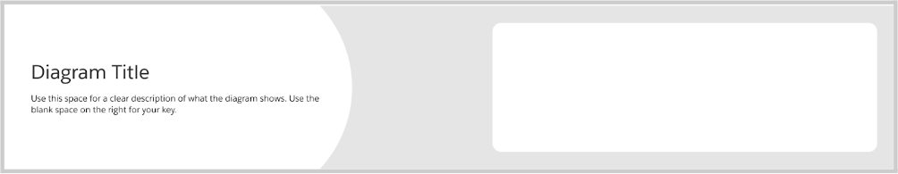
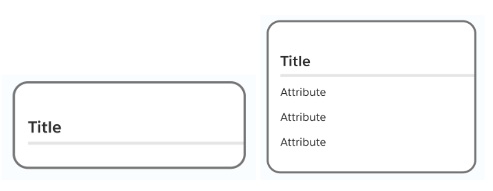
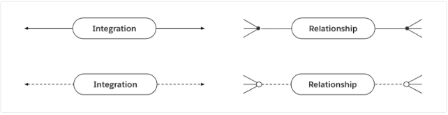
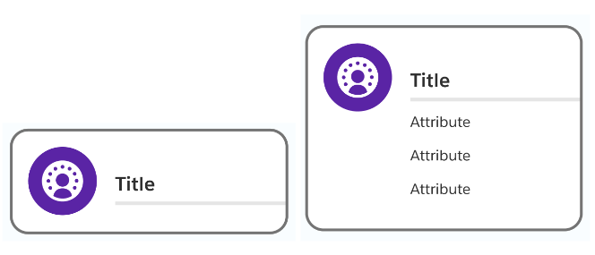
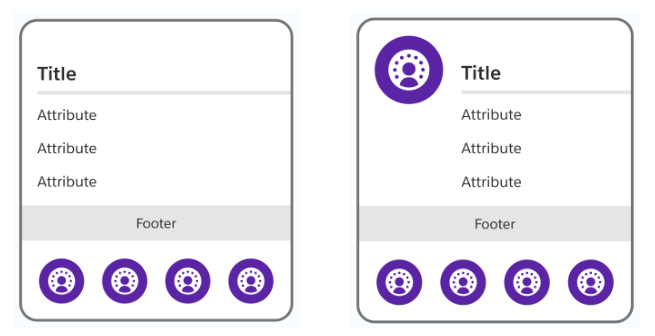

   

Diagrams are an essential tool and a key part of architectural work. They enable us to communicate many different ideas to many different kinds of stakeholders.

 

Diagrams help delivery teams stay aligned, by serving as a single source of truth about the realities of implementations and products. Diagrams are also a critical way to empower business stakeholders to make the right purchasing and technology decisions.

 

**Diagrams should always:**

 
 
- Read left to right and top to bottom, as closely as possible 
- Convey a message concisely, with an appropriate scope of information for readability 
- Utilize [Salesforce Diagrams Standard Components](https://architect.salesforce.com/docs/architect/reference-diagrams/guide/kit-of-parts), including Cards and a Header with a clear description describing the content, scope and purpose of the diagram 
  

The scope of a diagram should be limited to only the critical information to convey for a specific topic. Anything that is not required to capture the message you intend to communicate should be excluded. Multiple diagrams can (and should) be created to capture varying concepts, in order to more clearly communicate and narrow the focus of diagram content.

 
 
- Define the critical information/message you need to convey to your audience 
- Classify logical scope(s) in order to focus the information to capture the message 
- Identify the most appropriate diagram type(s) to use as templates 
  

Salesforce Diagrams has defined our most useful/popular types of diagrams in order to help you easily utilize templates and understand diagramming conventions. Our current resources are classified as:

  
 
- Capture the property mix and relevant, key capabilities included in a solution 
- Focus on functionality, business drivers and values 
 

✨ Find Capability Maps in the [Reference Architecture Gallery](https://architect.salesforce.com/docs/architect/reference-diagrams/guide/section-capability-map)

  
 
- Capture the products and/or technical systems involved in a given implementation 
- Focus on the properties, specific property aspects, and connections across properties 
 

✨ Find System Landscape examples & templates in the [Reference Architecture Gallery](https://architect.salesforce.com/docs/architect/reference-diagrams/guide/section-system-landscape)

  
 
- Include products or technologies with integration, behavior and/or functionality 
- Focus on the detailed connections and/or communication aspects across properties 
 

✨ Find Solution Architecture examples & templates in the [Reference Architecture Gallery](https://architect.salesforce.com/docs/architect/reference-diagrams/guide/section-solution-architecture)

  
 
- Help organizations plan and visualize the strategic implementation of capabilities, components, features, and systems over time 
- Provide a clear view of implementation order, dependencies, and priorities 
 

✨ Find Roadmap examples & templates in the [Reference Architecture Gallery](https://architect.salesforce.com/docs/architect/reference-diagrams/guide/section-roadmap)

  
 
- Capture time-based steps, data flows, or interactions required to support a process 
- Focus on and clarify (with sequenced numbering) the order of aspects/properties 
 

✨ Find examples & templates of Interaction, Process, and Flow diagrams in the [Reference Architecture Gallery](https://architect.salesforce.com/docs/architect/reference-diagrams/guide/section-interaction-process-flow)

  
 
- Capture entities (objects), relationships and concepts for metadata implementations 
 

✨ Find Data Model examples & templates in the [Data Model Gallery](https://developer.salesforce.com/docs/platform/data-models/guide/get-started.html)

 

See examples of the Diagram Types in the [Reference Architecture Gallery](https://architect.salesforce.com/diagrams) or our dedicated [Data Model Gallery](https://developer.salesforce.com/docs/platform/data-models/guide/get-started.html). Utilize a template to quickly/easily create a diagram for your use case.

  
 
- Define the **scope**  of the message you need to convey:

 
 
- Think about your audience, what properties/aspects you need to depict, what information is necessary to capture the message, and what can be excluded 
- Ensure there is a **Header**  with a clear **Title**  and a concise, thoughtfully-worded **Description**  that captures the purpose, scope and message of your diagram 
 

 
 
- Utilize **Cards**  to capture the properties (systems, concepts, entities, etc.) 
- Capture property details or key aspects / capabilities as needed in **Card Attributes** 
 

 
 
- Depict relationships as needed with **Connectors**  between your card properties 
 

 
 
- Incorporate **Card Icons**  where useful, available and/or appropriate 
 

 
 
- Use **Footers**  and **Footer icons**  to capture any other key property aspects 
 

 

**Warning:**  due to a current limitation with Lucidchart, the footer icons in diagrams that are created from a template become undocked from the card. You will need to re-dock the icons by dragging them into the center of the footer.

 

See the [Standard Components page](https://architect.salesforce.com/docs/architect/reference-diagrams/guide/kit-of-parts) for more details and best practices.

 

**Have Salesforce Diagrams input or questions?**  Please let us know your thoughts [here](https://docs.google.com/forms/d/e/1FAIpQLSe5RmVA2ZtpfGlR2u436FA4QN6QmJGdAWxtZ_AcRLMAH_US9Q/viewform).

   