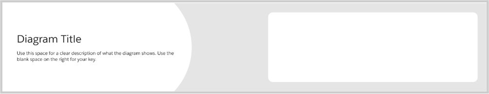
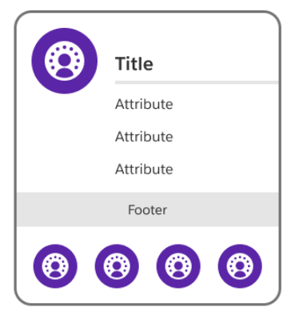
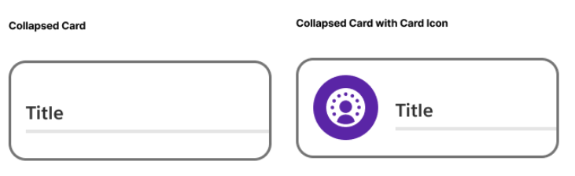
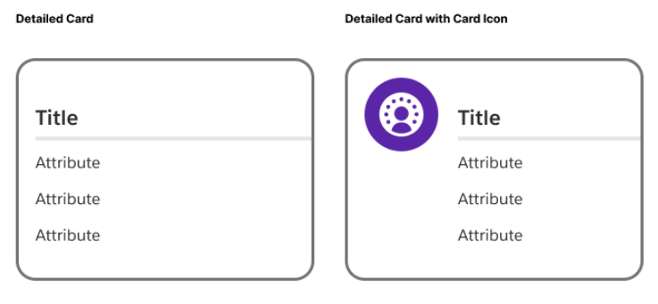
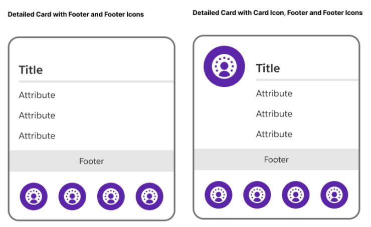
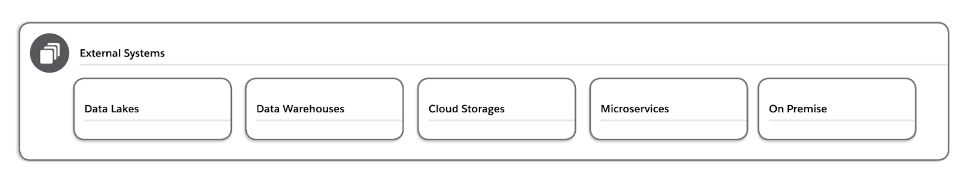
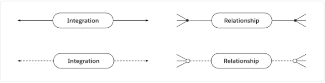
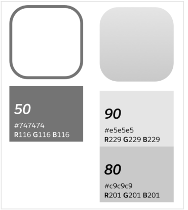

   

Standard Components make it easy for you to build, customize, and reuse high-quality, consistent diagrams. Salesforce recommends Lucid for architecture diagrams. Professional styling is utilized by all the Salesforce diagram shapes and templates.

 [Salesforce Shape Library and Templates in Lucidchart](https://www.lucidchart.com/blog/salesforce-shape-library)  

Find examples of how to use components in the [Reference Architecture Gallery](https://architect.salesforce.com/diagrams)

  

The following sections capture detailed best practices for the [Header](https://architect.salesforce.com/docs/architect/reference-diagrams/guide/introduction.html), [Cards](https://architect.salesforce.com/docs/architect/reference-diagrams/guide/introduction.html), [Icons](https://architect.salesforce.com/docs/architect/reference-diagrams/guide/introduction.html) and [Connectors](https://architect.salesforce.com/docs/architect/reference-diagrams/guide/introduction.html) included in the Standard Components.

  

 

The Header should be present on all diagrams and include:

 
 
- A title that can be quickly understood by your audience 
- A clear description of what the diagram covers, it’s purpose and intent 
- (optional) your logo or company name to convey the author 
- (optional) a Key to clarify icons, designs or symbols used as classifications 
 

The size should take up at least 10% of the diagram height and 100% of the width.

 

The font size of the description should be at least half the size of the title.

 

A Key should be included when Icons, connectors, colors, etc. are used that are not specified with titles on the diagram itself. The key should be grouped into even rows when possible.

  

All properties of your diagram should be represented with a card. Cards can be resized and they can have either transparent or colored fills. There are multiple sections of the card providing variations that you can use to represent different concepts in your diagram.

  

An example card is below, with the different sections described. The only required Card content is the Title. The other sections are available to utilize as needed for specific use cases.

 

 

**Card Icon**  Card icons are visual assets representing the card property

 

**Card Title**  The card title is a name for card that can be quickly understood, capturing what property, area or concept the card represents

 

**Card Attributes**  Card attributes are text-based details about the property, represented as a list and used when you need to capture and convey multiple points of data

 

**Card Footer**  The card footer provides additional characteristics of the property. Examples include: Package/ Object/ API names, Ownership, Capabilities, etc.

 

**Card Footer Icons**  The footer icons section is for visual assets to display additional information about the property. Examples include: channels, shared services, capabilities, etc. Footer icons should be included / explained in your diagram key.

 

Warning: due to a current limitation with Lucidchart, the footer icons in diagrams that are created from a template become undocked from the card. You will need to re-dock the icons by dragging them into the center of the footer.

  

Utilizing different sections provides different card variations for different uses. You can mix and match card anatomy as needed to create these variations in your diagrams. See examples below:

 

 

 

 

Refer to the [Reference Architecture Gallery](https://architect.salesforce.com/diagrams) for ideas on how to use these variations.

 

Make use of the ability to adjust your cards’ size and color as needed to distinguish types and create clear, understandable diagrams.

  

Cards can also act as containers i.e. groupings for multiple properties. You can nest cards inside of another card to represent hierarchical relationships or classify related properties as needed.

 

  

Salesforce Diagrams provide a basic set of Salesforce Product Logos as well as additional icons to represent properties and other areas in your diagram.

 

 

You can find examples of how to use Icons in the [Reference Architecture Gallery](https://architect.salesforce.com/diagrams)

 

For additional icons, refer to the [Lightning Design System icons.](https://www.lightningdesignsystem.com/icons/)

  

Connectors should always utilize elbow connection lines, and be straight whenever possible for greater readability.

 

 

**Connectors**  represent a relationship, integration, or process step between two cards. Line styles indicate a different type of connection and should be represented in your diagram key. Endpoints indicate direction of an integration or process connector. Endpoints also indicate cardinality and ordinality on a relationship connector.

 

**Pills**  are utilized to provide details about the connections. Refer to [Solution Architecture](https://architect.salesforce.com/docs/architect/reference-diagrams/guide/section-solution-architecture) and [Interaction Process Flow](https://architect.salesforce.com/docs/architect/reference-diagrams/guide/section-interaction-process-flow) diagrams for example uses of pills.

  

Around the world, approximately [1.3 billion](https://www.salesforce.com/company/legal/508_accessibility/) people live with some form of disability, accounting for 15% of the world’s population. Accessibility is about making your diagram understandable for all your viewers. There are two particular focus areas that can help your diagrams be more accessible: optimizing for screen readers and using color contrast appropriately.

 

You can find more resources on designing for accessibility on the [Salesforce Design blog](https://medium.com/salesforce-ux/tagged/accessibility).

 

**Screen Readers**  A screen reader is a software application that reads aloud the words in a file, app, or website. A screen reader can read diagrams to individuals who are unable to see it clearly. The best format for screen reader compatibility is PDF (Portable Document Format). Unlike images and non-accessible applications, PDFs can be accessed by screen readers for reading words, shapes, and colors. Exporting your diagrams to PDF format when sharing with others can boost accessibility.

 

**Color Contrast**  Increasing the color contrast is another way to help your diagram be more accessible. People will be better able to recognize and read your diagrams when they meet the [Web Content Accessibility Guidelines (WCAG) minimum color contrast](https://www.w3.org/TR/UNDERSTANDING-WCAG20/visual-audio-contrast-contrast.html) of having a 4.5:1 ratio between the background color behind the text and the color of the text itself.

 

 

Each color in the [Salesforce color system](https://medium.com/salesforce-ux/the-salesforce-color-system-c7c6b5b9c577) has a number, between 0 and 100, associated with it. When choosing colors for your diagrams, make sure the background color behind the text is at least 50 points greater than or less than the color of the text. For example, if your background color is 80, then your text color should be no higher than 30. Consider using the 50-point rule as needed for borders and outlines as well.

 

**Have Salesforce Diagrams input or questions?**  Please let us know your thoughts [here](https://docs.google.com/forms/d/e/1FAIpQLSe5RmVA2ZtpfGlR2u436FA4QN6QmJGdAWxtZ_AcRLMAH_US9Q/viewform).

   