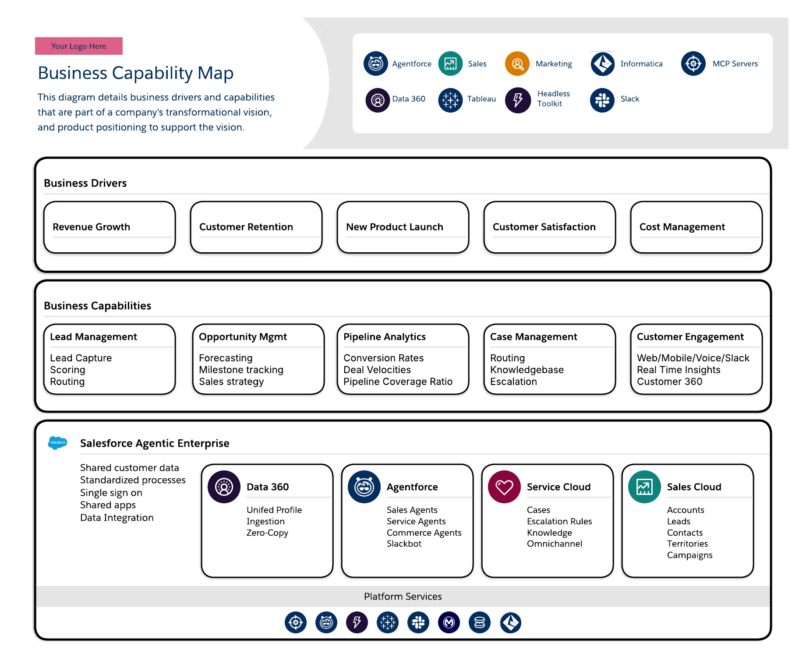

  

# Business Capability Map

 

  

A template capability map for depicting business drivers and capabilities with high-level product positioning. Business drivers are the high-level strategic goals or external pressures that push an organization to change how it operates. Example business drivers include:

 
 
- Revenue Growth 
- Operational Cost Reduction 
- Customer Retention 
  
 
- [Lucid](https://lucid.app/lucidchart/editNewOrRegister/fe6ccc24-6a13-4e0f-8076-1e5af8b08466) 
- [Image](https://architect.salesforce.com/ns-assets/reference-architectures/business-capability-map.webp) 
   