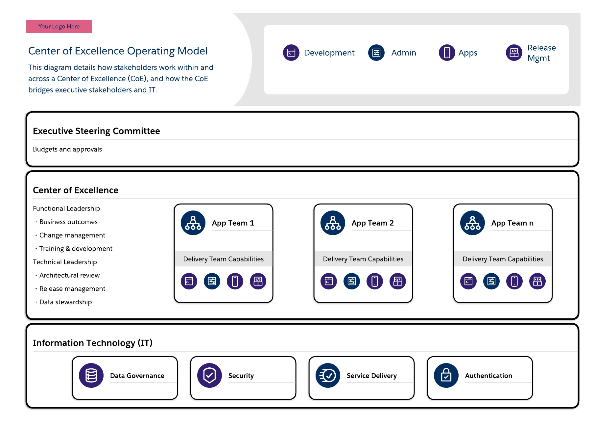

  

# Center Of Excellence

 

  

A diagram showing how a Center of Excellence (CoE) bridges executive stakeholders and IT. It highlights how functional and technical leadership capabilities are central to a CoE.

 

Centers of Excellence provide expertise and guidance across the enterprise. They provide value with activities such as:

 
 
- Establishing best practices for the implementation of the solutions 
- Enforce adherence to corporate standards and industry standard practices 
- As product experts, educate and train the project teams in the products 
- Solve hard problems that arise during implementation 
  
 
- [Lucid](https://lucid.app/lucidchart/editNewOrRegister/59956c3b-3c73-469b-87a4-44c6dad948e5) 
- [Image](https://architect.salesforce.com/ns-assets/reference-architectures/center-of-excellence.webp) 
   