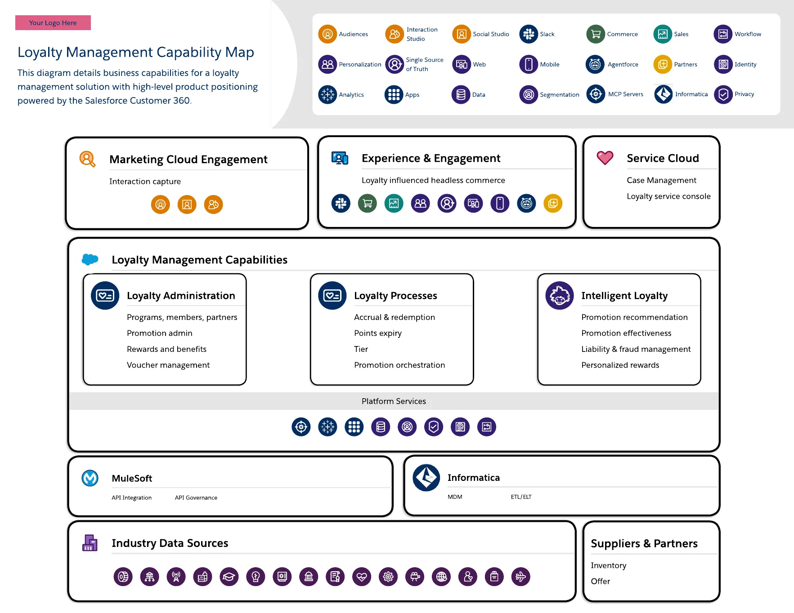

  

# Loyalty Management Capability Map

 

  

This capability map diagram shows loyalty management services with high-level product positioning. It includes capabilities such as Loyalty Administration, Processing, and Analytics. This solution uses Salesforce products such as Marketing Cloud Engagement, Agentforce Service, and MuleSoft.

  
 
- [Lucid](https://lucid.app/lucidchart/editNewOrRegister/d41ccba2-71ea-449a-8497-ea95396102b4) 
- [Image](https://architect.salesforce.com/ns-assets/reference-architectures/loyalty-management-capability-map.webp) 
   