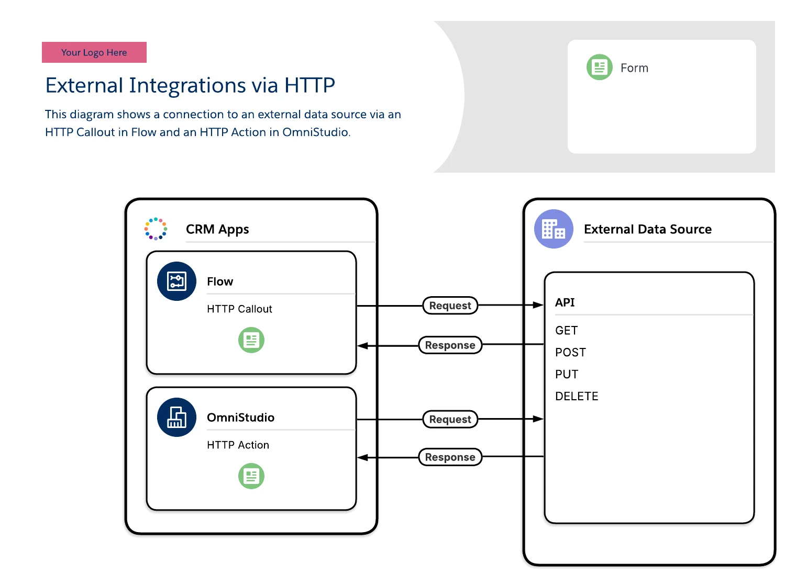

  

# External Integrations Via Http

 

  

This is an example solution architecture diagram from the Building Forms Decision Guide that shows a connection to an external data source via an HTTP Callout in Flow and an HTTP Action in OmniStudio. It shows the familiar request and response pattern of HTTP.

  
 
- [Lucid](https://lucid.app/lucidchart/editNewOrRegister/161cc130-341d-4c6d-84dc-00ca6aa00462) 
- [Image](https://architect.salesforce.com/ns-assets/reference-architectures/external-integrations-via-http.webp) 
   