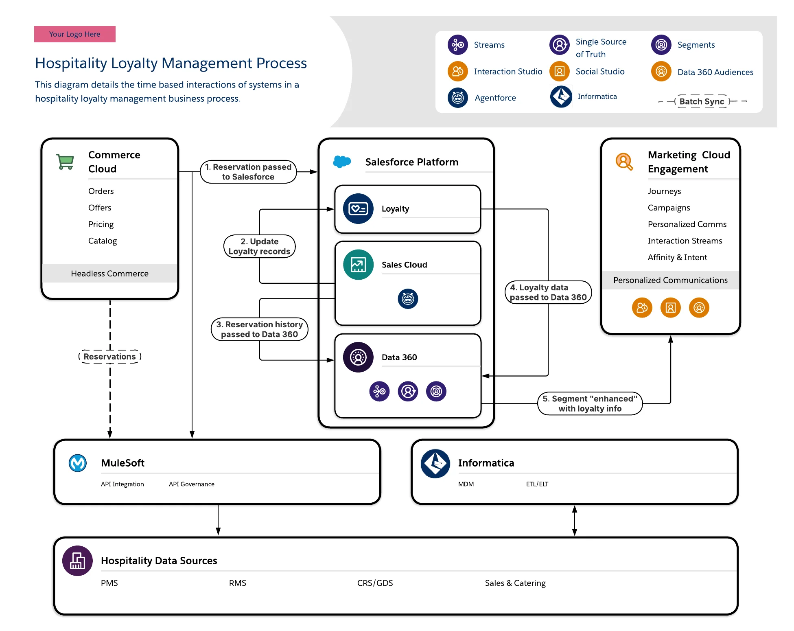

  

# Hospitality Loyalty Management Process

 

  

The time based interactions of systems in a hospitality loyalty management process. This flow traces the process through Agentforce Commerce, Agentforce Sales, Agentforce Platform, Data 360, Marketing Cloud Engagement, MuleSoft, and external data sources.

  
 
- [Lucid](https://lucid.app/lucidchart/editNewOrRegister/899f5366-4dea-4da7-81af-dc3939aece42) 
- [Image](https://architect.salesforce.com/ns-assets/reference-architectures/hospitality-loyalty-management-process.webp) 
   