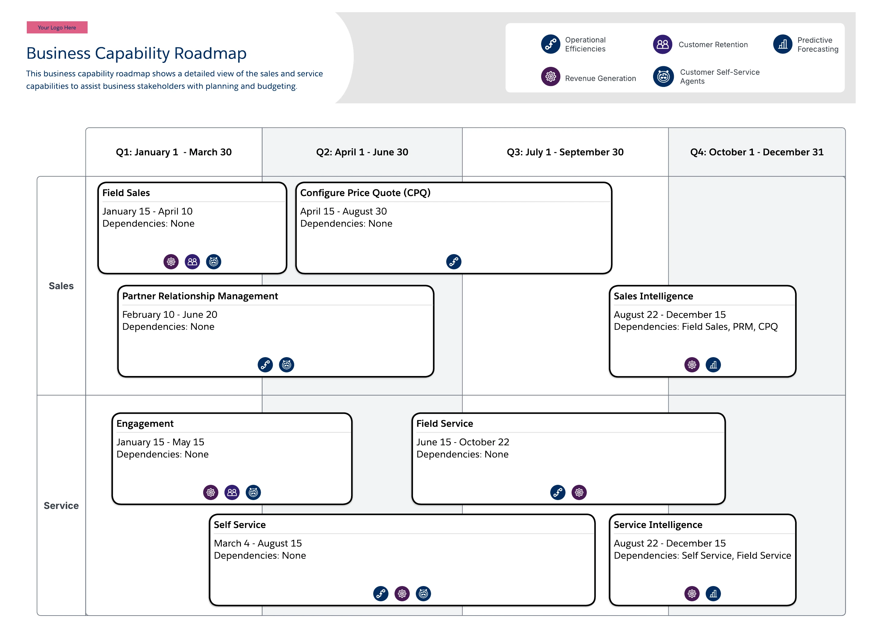

  

# Capability Roadmap

 

  

A visual roadmap that streamlines resource planning and budgeting by grouping capabilities and identifying implementation order, dependencies, and value. For each capability in this diagram, it is common to have a dedicated [Component Roadmap](https://architect.salesforce.com/docs/architect/reference-diagrams/guide/component-roadmap) to drill into the details of the delivery.

  
 
- [Lucid](https://lucid.app/lucidchart/editNewOrRegister/12103374-8b95-49bb-b7ad-b0f8154ccec6) 
- [Image](https://architect.salesforce.com/ns-assets/reference-architectures/capability-roadmap.webp) 
   