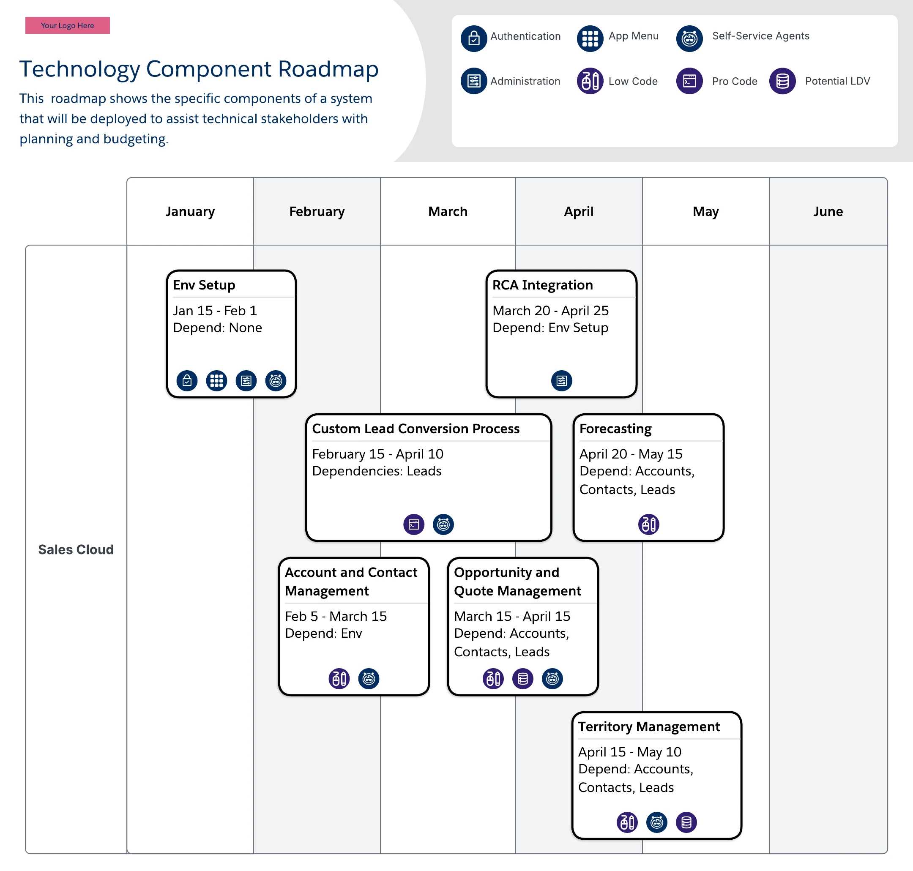

  

# Component Roadmap

 

  

This diagram contains a visual roadmap that optimizes resource planning and budgeting by identifying system functionality, relevant features, implementation order, timeframes, and stakeholder dependencies. This diagram is usually used as a detail view of one box in a [Capability Roadmap](https://architect.salesforce.com/docs/architect/reference-diagrams/guide/capability-roadmap). For each component in this diagram, it is common to have a dedicated [Feature Roadmap](https://architect.salesforce.com/docs/architect/reference-diagrams/guide/feature-roadmap) to drill into the details of the feature delivery.

  
 
- [Lucid](https://lucid.app/lucidchart/editNewOrRegister/2ca75fbd-af2e-45fd-a636-01255f1fb0cf) 
- [Image](https://architect.salesforce.com/ns-assets/reference-architectures/component-roadmap.webp) 
   