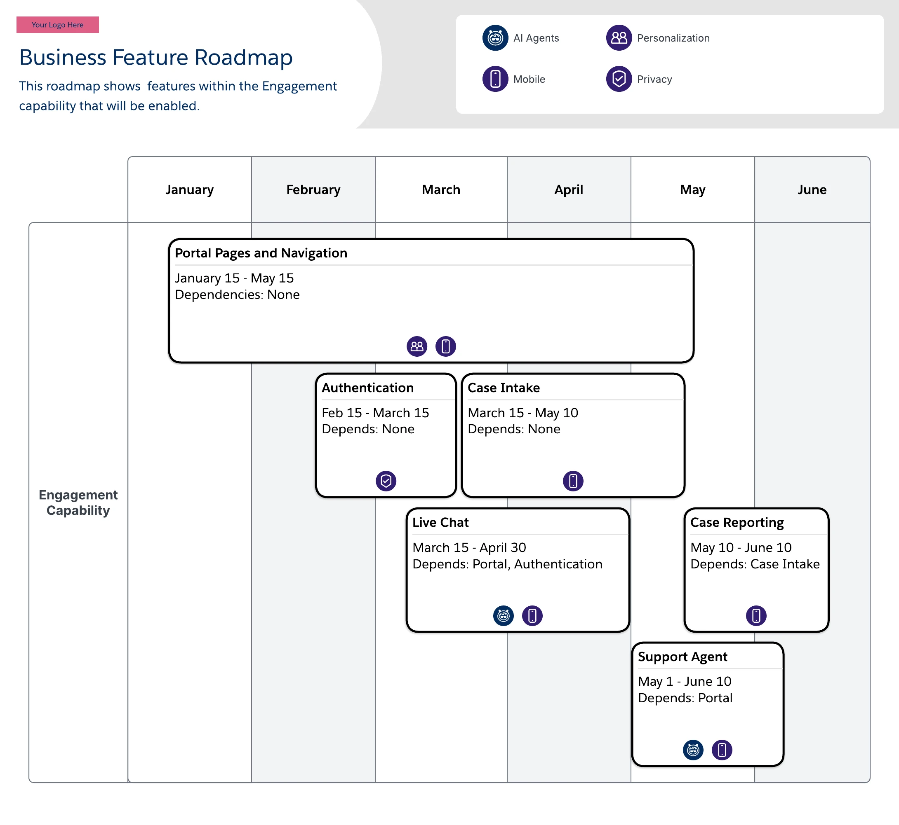

  

# Feature Roadmap

 

  

A visual roadmap diagram that enhances collaboration between business and technical teams by identifying feature implementation order, dependencies, and additional functionality for planning purposes. This diagram is usually used as a detail view of one box in a [Component Roadmap](https://architect.salesforce.com/docs/architect/reference-diagrams/guide/component-roadmap).

  
 
- [Lucid](https://lucid.app/lucidchart/editNewOrRegister/8e43258e-b21b-4525-87bf-8e5ba96f4032) 
- [Image](https://architect.salesforce.com/ns-assets/reference-architectures/feature-roadmap.webp) 
   