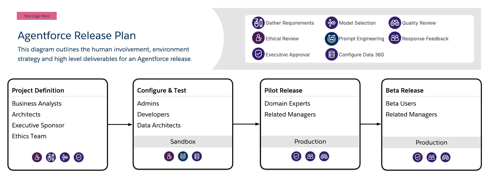

  

# Agentforce Release Plan

 

  

A roadmap diagram detailing the deliverables for an initial Agentforce project release. It includes stages such as Project Definition, Configure and Test, Pilot Release, and Beta Release.

  
 
- [Lucid](https://lucid.app/lucidchart/editNewOrRegister/241905d5-9a36-451d-952a-e43390349502) 
- [Image](https://architect.salesforce.com/ns-assets/reference-architectures/generative-ai-release-plan.webp) 
   