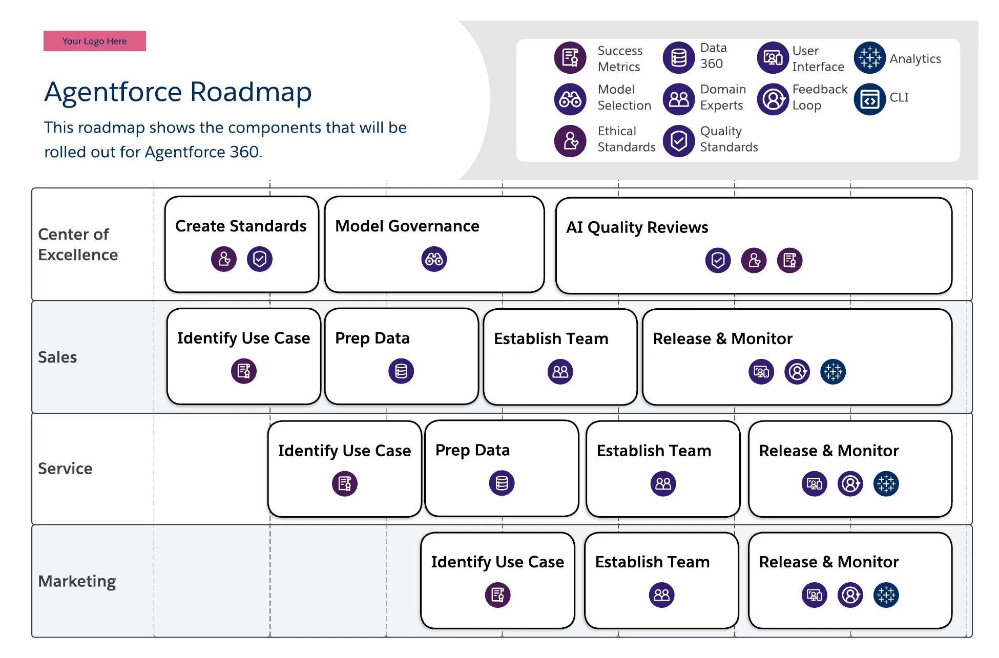

  

# Agentforce Roadmap

 

  

A roadmap diagram showing the stages for rolling out Agentforce features across a Salesforce Customer 360 implementation. This includes stages such as Create Standards, Model Governance, Prep Data, Establish Team, and Release & Monitor. Swimlanes include Center of Excellence, Sales, Service, and Developers.

  
 
- [Lucid](https://lucid.app/lucidchart/editNewOrRegister/1d9723f0-0835-4dc2-9cbb-01b2e97c91e8) 
- [Image](https://architect.salesforce.com/ns-assets/reference-architectures/generative-ai-roadmap.webp) 
   