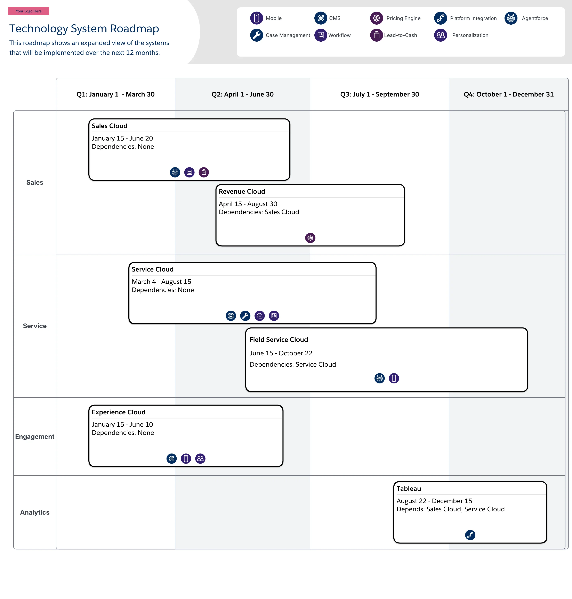

  

# System Roadmap

 

  

A roadmap diagram that simplifies resource planning and budgeting by identifying system implementation order, dependencies, functional areas, and relevant features for stakeholders.

  
 
- [Lucid](https://lucid.app/lucidchart/editNewOrRegister/ead3af9a-ddc2-492a-a8c9-7ab3943fabd7) 
- [Image](https://architect.salesforce.com/ns-assets/reference-architectures/system-roadmap.webp) 
   