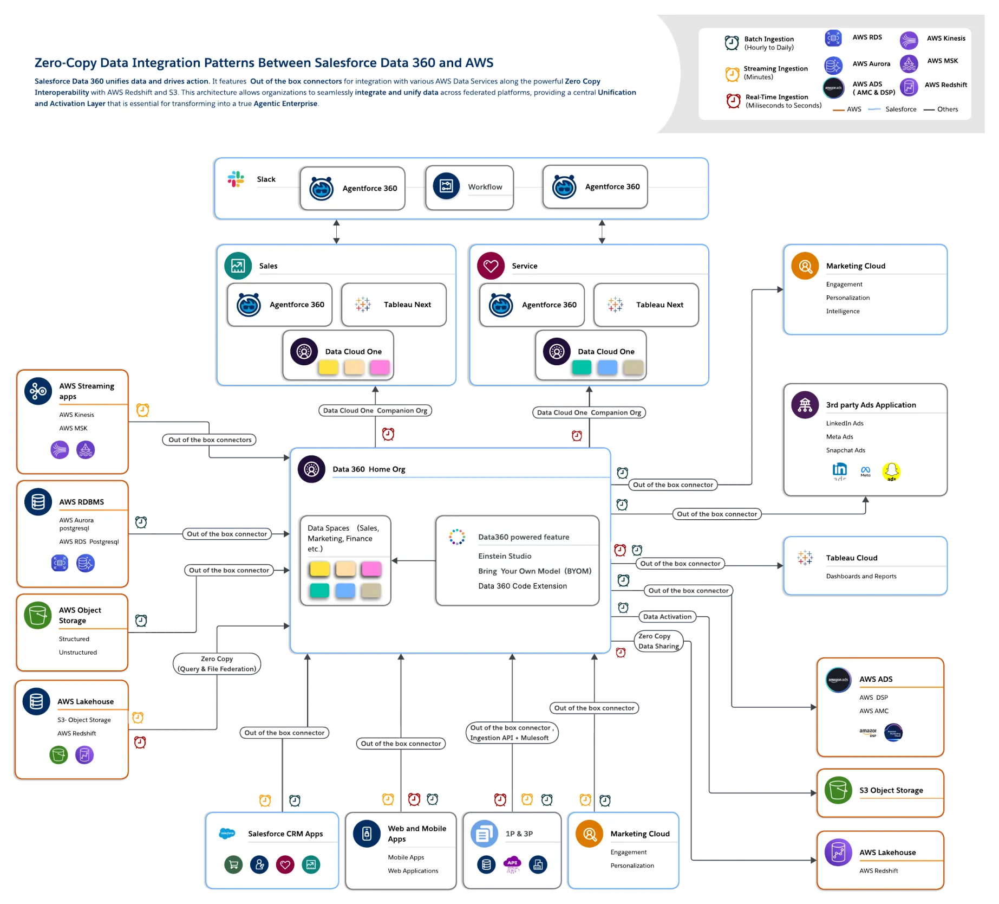

  

# Zero-Copy Data Integration Architecture with Data 360

 

  

A diagram depicting Salesforce Data 360 using out of the box connectors for integration with various AWS Data Services, along with powerful Zero Copy Interoperability with AWS Redshift and S3. This architecture allows organizations to seamlessly integrate and unify data across federated platforms, providing a central Unification and Activation Layer that is essential for transforming into a true Agentic Enterprise. It includes Salesforce products such as Agentforce 360, Tableau Next, Marketing Cloud, Data 360 and Agentforce Sales.

  

**Backend: Amazon Web Services**

 
 
- [Lucid](https://lucid.app/lucidchart/editNew/04991364-85c0-45e6-b5de-553367fbb473) 
- [Image](https://architect.salesforce.com/ns-assets/data360_ref_arch/data360-aws.webp) 
 

**Backend: Google Cloud Platform**

 
 
- [Lucid](https://lucid.app/lucidchart/editNew/4661f0e4-e86a-409b-9a98-8301cbbca74f) 
- [Image](https://architect.salesforce.com/ns-assets/data360_ref_arch/data360-gcp.webp) 
 

**Backend: Databricks**

 
 
- [Lucid](https://lucid.app/lucidchart/editNew/e74f6e22-ce6d-4b6d-a258-76ddb8f73f4e) 
- [Image](https://architect.salesforce.com/ns-assets/data360_ref_arch/data360-databricks.webp) 
 

**Backend: Snowflake**

 
 
- [Lucid](https://lucid.app/lucidchart/editNew/b02236c2-f3f4-4de8-b13b-35f67fd5390d) 
- [Image](https://architect.salesforce.com/ns-assets/data360_ref_arch/data360-snf.webp) 
   