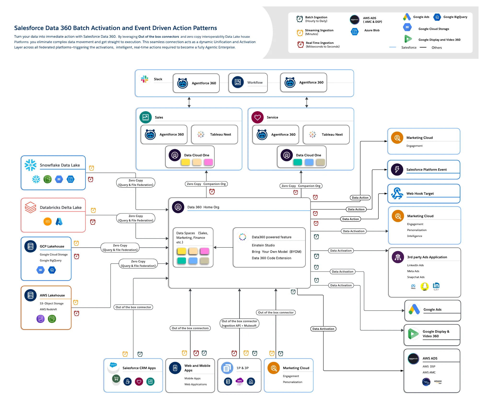

  

# Data 360 Batch Activation and Event Driven Action Architecture

 

  

This is a diagram depicting Salesforce Data 360 in an end-to-end solution for marketing activations. It shows how to build a complete solution with products such as Home Orgs, Companion Orgs, Data Cloud One, Agentforce 360, Agentforce Sales, Marketing Cloud, and Tableau Next.

  
 
- [Lucid](https://lucid.app/lucidchart/editNew/620837ec-bb08-4f1e-af26-1164fc5f789c) 
- [Image](https://architect.salesforce.com/ns-assets/data360_ref_arch/data360-actions-activations.webp) 
   