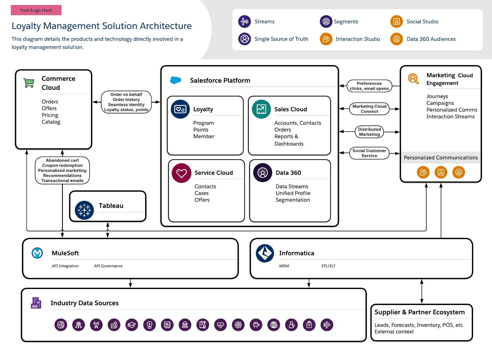

  

# Loyalty Management Solution Architecture

 

  

An architecture diagram that depicts the products and capabilities directly involved in a loyalty management solution. This includes Agentforce Commerce, Agentforce Sales, Agentforce Service, Marketing Cloud Engagement, MuleSoft, Data 360, and Tableau for analytics.

  
 
- [Lucid](https://lucid.app/lucidchart/editNewOrRegister/217c76c7-b8c4-44ed-aade-a7ae3fb8df0a) 
- [Image](https://architect.salesforce.com/ns-assets/reference-architectures/loyalty-management-solution-architecture.webp) 
   