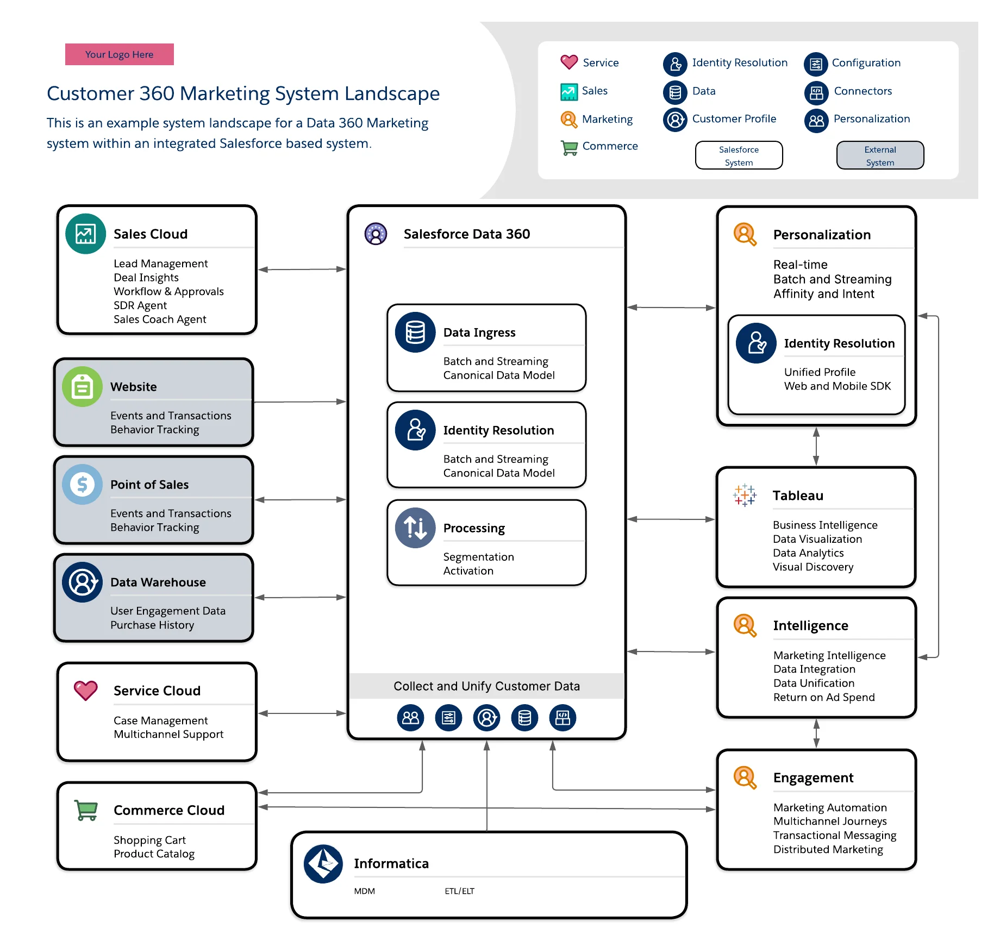

  

# Customer 360 Marketing System Landscape

 

  

This is a system landscape diagram for a Customer 360 implementation, including Agentforce Sales, Agentforce Service, Agentforce Commerce, Tableau, and Data 360. It shows how different components within an integrated Salesforce solution communicate with each other using native connectors and custom connectors. It includes capabilities such as Data Ingress, Identity Resolution, Segmentation, and Activation.

  
 
- [Lucid](https://lucid.app/lucidchart/editNewOrRegister/e83190b9-5d7d-4468-aff9-882c9086e73f) 
- [Image](https://architect.salesforce.com/ns-assets/reference-architectures/data-360-marketing.webp) 
   