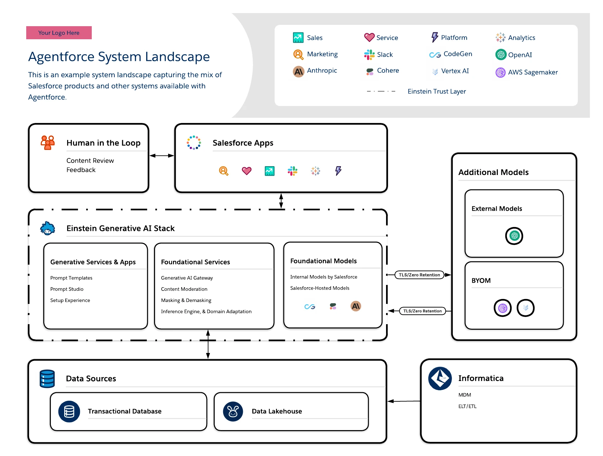

  

# Agentforce System Landscape

 

  

A system landscape capturing the mix of Salesforce products and other technology systems available with Agentforce. It shows how the Einstein trust layer and generative AI stack (prompt templates, LLM gateway, external models, BYOM) combine with Data 360 to provide a powerful foundation on which to build powerful agentic applications.

  
 
- [Lucid](https://lucid.app/lucidchart/editNewOrRegister/28e332b9-b4d5-4780-8220-12e097f0dc58) 
- [Image](https://architect.salesforce.com/ns-assets/reference-architectures/einstein-system-landscape.webp) 
   