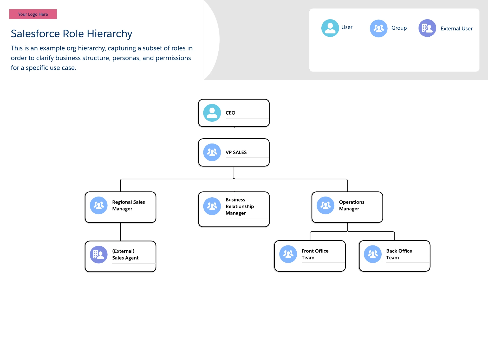

  

# Salesforce Role Hierarchy

 

  

A diagram depicting an example org hierarchy, capturing a subset of roles in order to clarify business structure, personas, and permissions for a specific use case. This isn’t a typical Landscape diagram, but is similar in that it shows a conceptual plan for how roles are related and model the business domain.

  
 
- [Lucid](https://lucid.app/lucidchart/editNewOrRegister/4fe3cd5e-0ccf-4ffd-9f7c-a418ce615c67) 
- [Image](https://architect.salesforce.com/ns-assets/reference-architectures/salesforce-role-hierarchy.webp) 
   