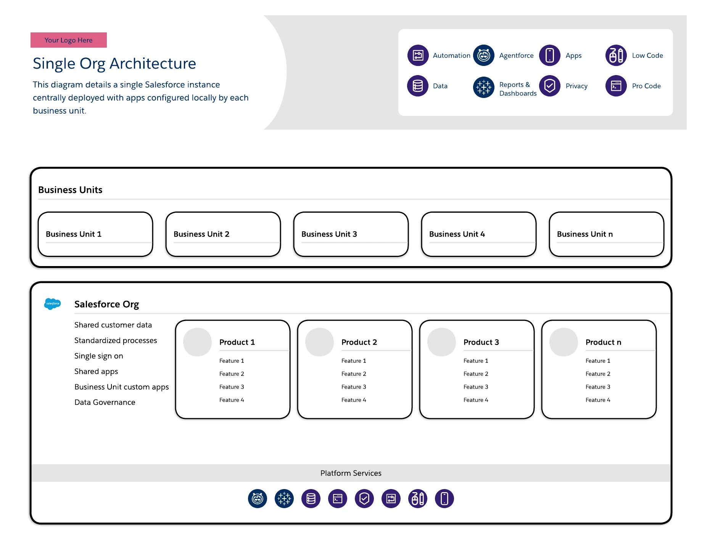

  

# Single Org Architecture

 

  

A diagram detailing a single org strategy supporting multiple business units. The lower box may contain the list of products in use (as depicted above) or may list the capabilities needed for the business units such as Shopping Cart, Lead Management, or Case Management.

  
 
- [Lucid](https://lucid.app/lucidchart/editNewOrRegister/92edbe8d-18b8-4998-a851-7d1e815ea7d5) 
- [Image](https://architect.salesforce.com/ns-assets/reference-architectures/single-org-architecture.webp) 
   